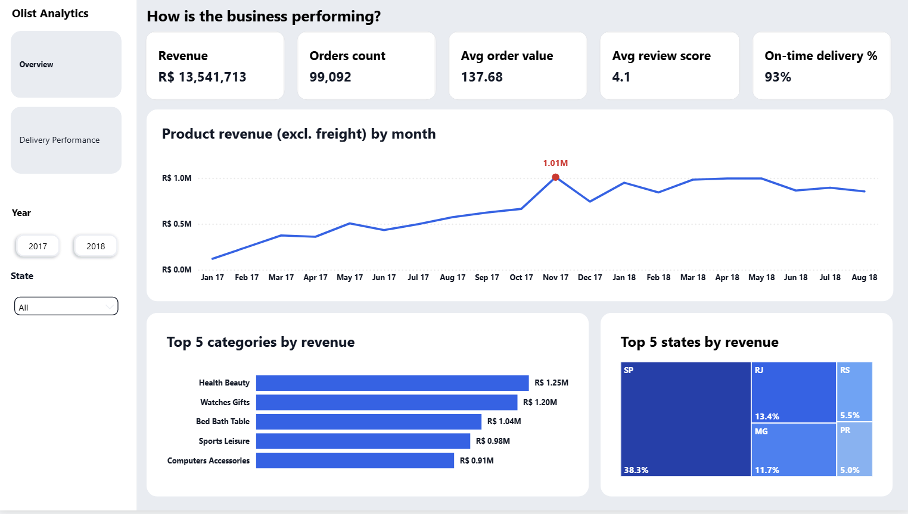

# Olist E-commerce: Sales and Delivery Performance Dashboard

**How is the business doing, and where is delivery failing?**

A two-page Power BI dashboard on **99,092 orders** from Olist, a Brazilian e-commerce marketplace (January 2017 to August 2018).

**Tools:** Power BI Desktop, Power Query (M), DAX, data modelling

**[Open the full dashboard as a PDF](Olist_Dashboard.pdf)**




---

## The two questions

1. **How is the business performing?** Revenue, orders, average order value and customer satisfaction over time, by state and by product category.
2. **How reliably do orders arrive?** On-time delivery by month, where delivery is slow and which sellers are most often late.

The dashboard is built for a marketplace manager or operations lead who needs to decide where to focus.

## Key numbers

| Metric | Value |
|:--|:--|
| Product revenue (excl. freight) | R$ 13.54M |
| Orders | 99,092 |
| Average order value | R$ 137.68 |
| Average review score | 4.09 out of 5 |
| On-time delivery | 93.2% |
| Late orders | 6,532 |
| Average delivery time | 12.5 days |
| Average delay (late orders only) | 10.6 days |

## Key findings

**Sales**
- Revenue peaked in **November 2017** at **R$ 1.01M**, the month of Black Friday.
- **São Paulo (SP)** alone brings in **38.3%** of revenue. The top 5 states (SP, RJ, MG, RS, PR) bring in about **74%**.
- The top categories are **Health & Beauty, Watches & Gifts, Bed Bath & Table, Sports & Leisure and Computer Accessories**.
- In the last full month (August 2018), orders grew **3.5%** on July but revenue fell **4.6%**: customers ordered more, but spent less per order.

**Delivery**
- On-time delivery is strong overall (**93.2%**) but fell **below 90% in three months**: November 2017 (88%), February 2018 (86%) and March 2018 (81%). The November drop came with the Black Friday peak.
- Delivery time depends heavily on location. Northern states such as **Roraima (29.9 days), Amapá (27.2) and Amazonas (26.4)** wait more than twice the national average of 12.5 days.
- Among sellers with 50 or more orders, the worst deliver only **70–79%** of orders on time, a short list for follow-up.

## What the business should do

| What the data shows | Decision it supports |
|:--|:--|
| On-time delivery fell to 88% in the Black Friday month, and to 81–86% in February–March 2018 | Agree extra carrier and warehouse capacity before November, and set realistic delivery dates in peak weeks |
| Northern states wait about twice the national average | Show region-specific delivery estimates at checkout, and look at regional carriers or local hubs for the North |
| A few sellers with 50+ orders are on time only 70–79% of the time | Use the seller table as a monthly watch-list with a minimum on-time target, for example 90% |
| SP brings in 38% of revenue, and the top 5 states 74% | Protect delivery quality in the core states, and plan growth in other regions to reduce the dependence on one state |
| August 2018: more orders, less revenue | Track average order value next to order count, and test bundles or free-shipping thresholds if it keeps falling |

## Dashboard pages

### 1. Overview
- **KPI cards:** revenue, orders, average review score and average order value
- **Line chart** of monthly product revenue, with the peak month marked
- **Bar chart** of the top 5 categories by revenue and a **treemap** of the top 5 states' share of revenue
- **Slicers** for year and customer state

### 2. Delivery Performance
- **KPI cards:** on-time delivery %, average delivery time, late orders and average delay. Problem numbers are shown in red
- **Combo chart** of on-time delivery % by purchase month, with the average as a reference line and months below 90% shaded
- **Bar chart** of the slowest states, with the national average as a reference line
- **Table** of sellers with 50+ orders, ranked by on-time delivery, with conditional formatting

Page navigation buttons and synced slicers link the two pages.

## Data

[Brazilian E-Commerce Public Dataset by Olist](https://www.kaggle.com/datasets/olistbr/brazilian-ecommerce) (Kaggle). Tables used: orders, order items, payments, customers, products, sellers and reviews.

## Data model


- **`olist_orders_dataset`** is the central table, one row per order.
- **Order items, payments and customers** link to orders on `order_id` and `customer_id`.
- **Products and sellers** link to order items.
- A **Date table** links to the purchase date and is used for all time-based measures.
- Measures are grouped in display folders: **Sales** and **Delivery**.

## Data preparation (Power Query)

- Fixed data types and date formats with the correct locale
- Merged review scores into the orders table
- Translated product category names to English, and replaced missing categories with "Unknown"
- Created delivery columns: delivery days, delay days (actual vs estimated date) and delivery status (On time / Late / Not delivered)
- Created shortened seller IDs for readable labels

## Selected DAX measures

**Average order value.** Only orders that contain items are counted, so cancelled or unavailable orders with no products don't pull the average down.
```dax
Orders With Items =
CALCULATE (
    COUNTROWS ( olist_orders_dataset ),
    NOT ISBLANK ( olist_orders_dataset[Items In Order] )
)

Average Order Value =
DIVIDE ( [Revenue], [Orders With Items] )
```

**On-time delivery %**
```dax
Delivered Orders =
CALCULATE ( COUNTROWS ( olist_orders_dataset ), olist_orders_dataset[Delivery Status] <> "Not delivered" )

Late Orders =
CALCULATE ( COUNTROWS ( olist_orders_dataset ), olist_orders_dataset[Delivery Status] = "Late" )

On-Time Delivery % =
DIVIDE ( [Delivered Orders] - [Late Orders], [Delivered Orders] )
```

## Definitions and assumptions

- **Period:** orders purchased from **January 2017 to August 2018**. The first and last months of the raw data have very few orders and would show a false collapse in revenue, so they are excluded.
- **Revenue** is the product price of order items. It **excludes freight** (another R$ 2.24M) and includes items from all order statuses.
- **On time** means delivered on or before the estimated delivery date. Undelivered orders are left out of the on-time rate.
- **On-time delivery by month** groups orders by **purchase month**, not delivery month.
- **Average review score** includes only orders that received a review.
- Currency is the **Brazilian real (R$)**.

## Repository structure

```text
├── Olist_Dashboard.pdf   # Both dashboard pages, exported from Power BI
├── figures/              # Screenshots of both pages and the data model
└── README.md
```
