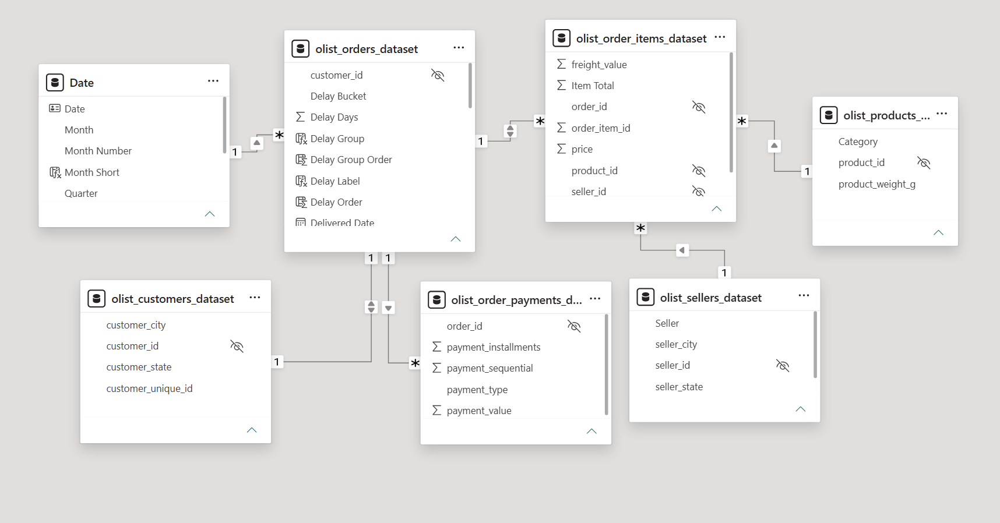

# Olist E-commerce: Sales & Delivery Performance Dashboard

A two-page Power BI dashboard analysing **99,000+ orders** from Olist, a Brazilian e-commerce marketplace. It answers two business questions:

1. **How is the business performing?** Revenue, orders, average order value and customer satisfaction over time, by state and by product category.
2. **How reliably do orders arrive?** On-time delivery, where delivery is slow, and which sellers are most often late.


---

## Key findings

| Metric | Value |
|---|---|
| Product revenue (excl. freight) | R$ 13.54M |
| Orders | 99,092 |
| Average order value | R$ 137.68 |
| Average review score | 4.09 / 5 |
| On-time delivery | 93.2% |
| Late orders | 6,532 |
| Average delivery time | 12.5 days |
| Average delay (late orders only) | 10.6 days |

**Sales**
- Revenue peaked in **November 2017** at R$ 1.01M, driven by Black Friday.
- **São Paulo (SP)** alone generates **38.3%** of revenue. The top 5 states (SP, RJ, MG, RS, PR) together account for about 74%.
- The top categories by revenue are **Health & Beauty, Watches & Gifts, Bed Bath & Table, Sports & Leisure and Computer Accessories**.
- In the latest month (Aug 2018), orders grew **+3.5%** while revenue fell **−4.6%**, so customers were buying more but cheaper orders.

**Delivery**
- On-time delivery is strong overall (93.2%) but fell **below 90% in three months**: Nov 2017, Feb 2018 and Mar 2018. The November drop shows the Black Friday peak strained logistics.
- Delivery time depends heavily on geography. Northern states such as **Roraima (29.9 days), Amapá (27.2) and Amazonas (26.4)** take more than twice the national average of 12.5 days.
- Among sellers with 50+ orders, the worst performers deliver only **70–79%** of orders on time. This makes them a clear, short list for seller-performance follow-up.

---

## Dashboard pages

### 1. Overview
- KPI cards: revenue and orders, each with a month-on-month change (green/red), average order value, on-time delivery % and average review score
- Line chart of monthly product revenue, with the peak month highlighted
- Treemap of the top 5 states by revenue share
- Bar chart of the top 5 categories by revenue
- Slicers for year and customer state

### 2. Delivery Performance
- KPI cards: on-time delivery %, late orders, average delivery days and average days late
- Combo chart of on-time delivery % by purchase month, with an average line and months below 90% highlighted
- Bar chart of the slowest states, with a dynamic national-average reference line
- Table ranking sellers (50+ orders) by on-time delivery, with conditional formatting
- Page navigation buttons and synced slicers

---

## Dataset

[Brazilian E-Commerce Public Dataset by Olist](https://www.kaggle.com/datasets/olistbr/brazilian-ecommerce) (Kaggle).

Tables used: orders, order items, payments, customers, products, sellers and reviews. Product categories were translated from Portuguese to English.

---

## Data model



- **`olist_orders_dataset`** is the central table, with one row per order.
- **Order items, payments and customers** link to orders on `order_id` / `customer_id`.
- **Products and sellers** link to order items.
- A dedicated **Date table** links to the order purchase date and is used for all time intelligence.
- Measures are organised in display folders: **Sales** and **Delivery**.

---

## Data preparation (Power Query)

- Fixed data types and date formats with the correct locale
- Merged review scores into the orders table
- Translated product category names to English and replaced missing categories with "Unknown"
- Created delivery columns: delivery days, delay days (actual vs estimated delivery date) and delivery status (On time / Late / Not delivered)
- Created shortened seller IDs for readable labels

---

## Selected DAX measures

**Average order value.** Only orders that contain items are counted, so cancelled or unavailable orders with no products don't pull the average down.
```dax
Orders With Items =
CALCULATE (
    COUNTROWS ( olist_orders_dataset ),
    NOT ISBLANK ( olist_orders_dataset[Items In Order] )
)

Average Order Value =
DIVIDE ( [Revenue], [Orders With Items] )
```

**On-time delivery %**
```dax
Delivered Orders =
CALCULATE ( COUNTROWS ( olist_orders_dataset ), olist_orders_dataset[Delivery Status] <> "Not delivered" )

Late Orders =
CALCULATE ( COUNTROWS ( olist_orders_dataset ), olist_orders_dataset[Delivery Status] = "Late" )

On-Time Delivery % =
DIVIDE ( [Delivered Orders] - [Late Orders], [Delivered Orders] )
```

**Month-on-month change for the latest month** (drives the green/red KPI subtitles)
```dax
Revenue MoM Latest % =
VAR LastDay   = MAX ( olist_orders_dataset[Purchase Date] )
VAR ThisMonth = FORMAT ( LastDay, "YYYY-MM" )
VAR PrevMonth = FORMAT ( EOMONTH ( LastDay, -1 ), "YYYY-MM" )
VAR Cur  = CALCULATE ( [Revenue], 'Date'[Year-Month] = ThisMonth )
VAR Prev = CALCULATE ( [Revenue], 'Date'[Year-Month] = PrevMonth )
RETURN DIVIDE ( Cur - Prev, Prev )
```

**Seller ranking** (only sellers with 50+ orders, so small sellers don't distort the ranking)
```dax
Seller Rank =
IF (
    [Orders Count] >= 50,
    RANKX (
        FILTER ( ALLSELECTED ( olist_sellers_dataset ), [Orders Count] >= 50 ),
        [On-Time Delivery %], , ASC
    )
)
```

**Dynamic chart title** (counts the months below target in the current selection)
```dax
On-Time Title =
VAR T    = ADDCOLUMNS ( ALLSELECTED ( 'Date'[Month Short] ), "Rate", [On-Time Delivery %] )
VAR Weak = COUNTROWS ( FILTER ( T, [Rate] < 0.9 ) )
RETURN
    IF ( Weak = 0,
        "On-time delivery stayed above 90% every month",
        "On-time delivery fell below 90% in " & Weak & IF ( Weak = 1, " month", " months" ) )
```

---

## Definitions & assumptions

- **Period:** orders purchased from **January 2017 to August 2018**. The first and last months of the raw data contain very few orders and would show a false collapse in revenue, so they are excluded.
- **Revenue** is the product price of order items. It **excludes freight** (another R$ 2.24M) and includes items from all order statuses.
- **On-time** means the order was delivered on or before the estimated delivery date. Undelivered orders are excluded from the on-time rate.
- **On-time delivery by month** groups orders by **purchase month**, not delivery month.
- **Average review score** includes only orders that received a review.
- Currency is **Brazilian Real (R$)**.

---

## Tools

- **Power BI Desktop:** Power Query, data modelling, DAX, report design
- **Power Query (M):** data cleaning and transformation

---

## How to open

1. Download `bi_project.pbix`.
2. Open it in [Power BI Desktop](https://www.microsoft.com/power-bi/desktop) (free, Windows).
3. Or view the static version in `olist_dashboard.pdf`.

---

## Author

**Lilit Poghosyan**: data analyst based in Amsterdam, with a background in fraud analytics and business intelligence.

[LinkedIn](https://www.linkedin.com/in/YOUR-PROFILE) · [Email](mailto:YOUR-EMAIL)
