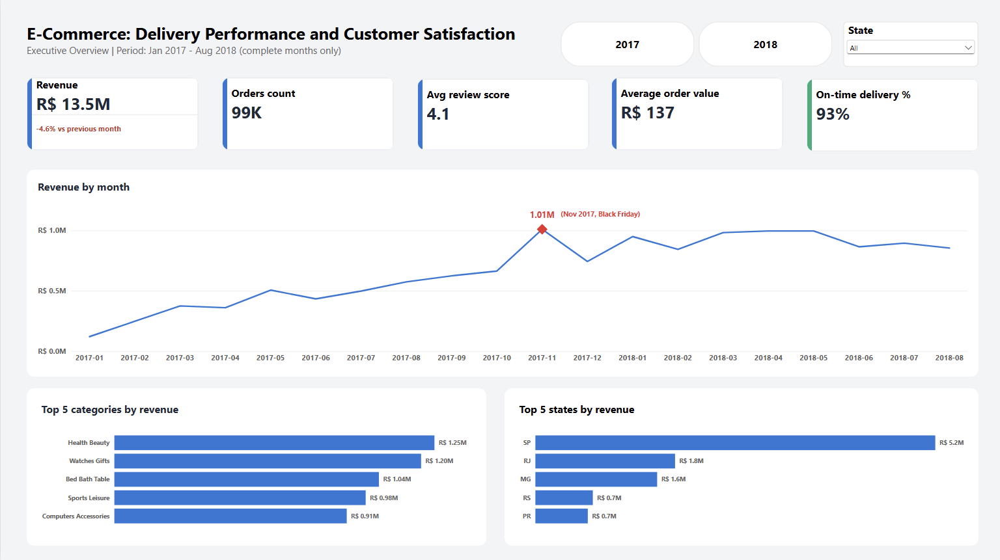
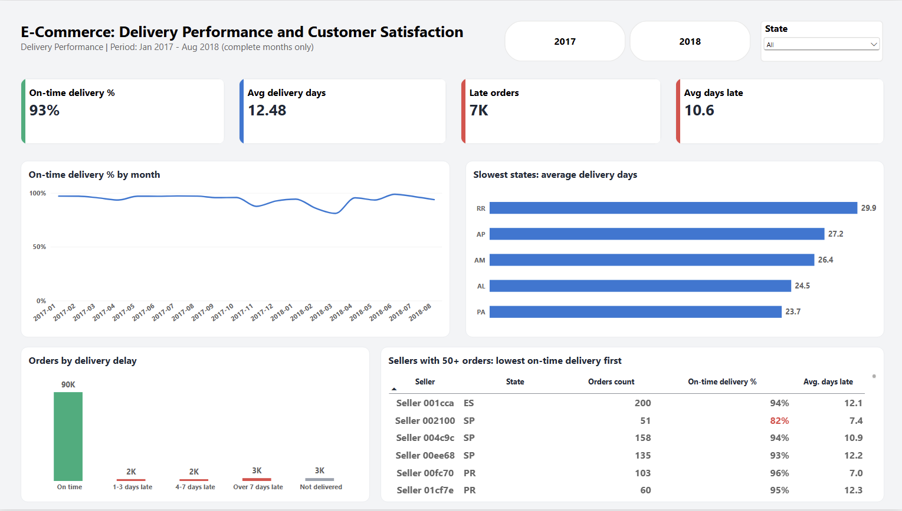
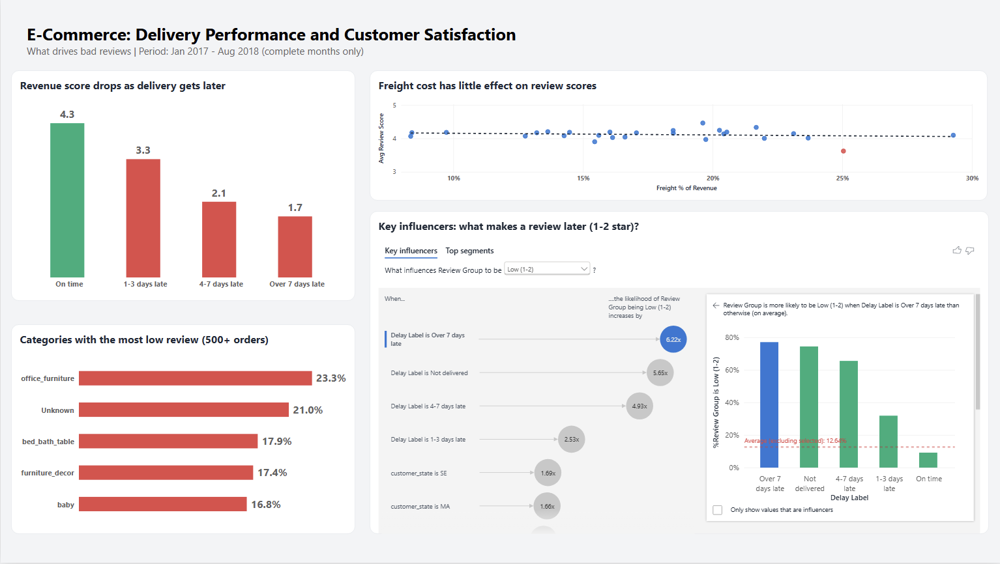

# E-Commerce: Delivery Performance and Customer Satisfaction

A three-page Power BI report on the Olist Brazilian e-commerce marketplace. It answers one
business question: **what drives bad customer reviews?**

**Tools:** Power BI Desktop, Power Query, DAX
**Data:** [Brazilian E-Commerce Public Dataset by Olist](https://www.kaggle.com/datasets/olistbr/brazilian-ecommerce) (Kaggle)
**Period analysed:** January 2017 to August 2018 (complete months only)

## Key findings

1. **Late delivery is the main driver of bad reviews.** Orders delivered on time average
   4.3 stars. The score falls to 3.3 for orders 1-3 days late, 2.1 for 4-7 days late and
   1.7 for orders more than 7 days late.
2. **The later the order, the more likely a low review.** In the Key influencers analysis,
   a 1-2 star review is 2.5 times more likely for orders 1-3 days late, 4.9 times for 4-7 days
   late, 6.2 times for more than 7 days late, and 5.7 times for orders never delivered.
3. **Freight cost has almost no effect on reviews.** Across product categories, freight ranges
   from about 8% to 29% of revenue, while average review scores stay close to 4.1; the trend
   line is nearly flat. One category stands apart at about 3.6 stars.
4. **A few product categories attract far more low reviews.** Among categories with at least
   500 orders, office furniture has the highest share of 1-2 star reviews (23.3%), followed by
   products with no category recorded (21.0%), bed, bath and table (17.9%), furniture and decor
   (17.4%) and baby (16.8%).
5. **Delivery is reliable overall, with clear weak spots.** 93% of delivered orders arrive on
   time, in 12.5 days on average. About 7 thousand orders arrived late, by 10.6 days on
   average, and about 3 thousand were not delivered. On-time delivery dipped around Black
   Friday 2017 and again in February-March 2018. The slowest states are in the north and
   northeast of Brazil: Roraima (29.9 days), Amapa (27.2), Amazonas (26.4), Alagoas (24.5) and
   Para (23.7), around twice the national average.

## Report pages

### 1. Overview
Revenue (R$ 13.5M), orders (99K), average order value (R$ 137), on-time delivery (93%) and
average review score (4.1), with the monthly revenue trend, the top five product categories
and the top five states by revenue.

- Revenue grew through 2017, peaked in November 2017 at R$ 1.01M (Black Friday), and held at
  roughly R$ 0.9-1.0M a month in 2018.
- Top categories: health and beauty (R$ 1.25M), watches and gifts (R$ 1.20M), bed, bath and
  table (R$ 1.04M), sports and leisure (R$ 0.98M), computers and accessories (R$ 0.91M).
- Sao Paulo state leads with R$ 5.2M, more than Rio de Janeiro (R$ 1.8M), Minas Gerais
  (R$ 1.6M), Rio Grande do Sul (R$ 0.7M) and Parana (R$ 0.7M) combined.



### 2. Delivery Performance
On-time delivery rate (93%), average delivery days (12.5), late orders (7K) and average days
late (10.6), with the monthly on-time trend, the five slowest states, orders by delivery
delay, and a table of sellers with at least 50 orders showing their on-time rate, with rates
below 90% highlighted.

- About 90 thousand orders arrived on time; roughly 2 thousand were 1-3 days late, 2 thousand
  4-7 days late, 3 thousand more than 7 days late, and 3 thousand were not delivered.



### 3. What Drives Bad Reviews
Average review score by delivery delay (4.3, 3.3, 2.1, 1.7), a Key influencers analysis of
low reviews, the five product categories with the highest share of low reviews, and freight
share against review score by category with a trend line.



## Data model

Eight CSV files loaded and shaped in Power Query, modelled as a star schema with a date table.

| Table | Grain | Role |
|---|---|---|
| Orders | one row per order | fact: status, delivery dates, review score |
| Order Items | one row per product in an order | fact: price, freight |
| Payments | one row per payment | fact: payment type and value |
| Customers | one row per order's customer | dimension: city, state |
| Products | one row per product | dimension: category (English) |
| Sellers | one row per seller | dimension: city, state |
| Date | one row per day | dimension: year, month, weekday |

Modelling decisions:

- **Customers to Orders is one-to-one.** Olist issues a new `customer_id` for every order, so
  real customers are counted with `customer_unique_id`.
- **Orders to Order Items filters in both directions**, so delivery and review measures (on
  Orders) can be sliced by product category and seller (through Order Items).
- **Review scores are merged into Orders** in Power Query, averaged per order, because a few
  orders have more than one review.
- **Incomplete months are excluded** with a report-level date filter, since the first months of
  2016 and the last weeks of 2018 contain only a handful of orders.

## Power Query steps

- Set data types; load prices with English (US) locale
- Derived columns on Orders: purchase, delivered and estimated dates; delivery days; delay
  days; delivery status (on time, late, not delivered); delay bucket
- Reviews grouped by order and merged into Orders
- Product categories translated to English through a merge with the translation table
- Short seller labels created from the seller ID

## Main DAX measures

```DAX
Revenue = SUM ( 'Order Items'[price] )

On-Time Delivery % =
DIVIDE ( [Delivered Orders] - [Late Orders], [Delivered Orders] )

Avg Review Score = AVERAGE ( Orders[Review Score] )

Low Review % =
DIVIDE (
    CALCULATE ( COUNTROWS ( Orders ), Orders[Review Score] <= 2 ),
    [Reviewed Orders]
)

Revenue MoM Latest % =
VAR LastDay = MAX ( Orders[Purchase Date] )
VAR ThisMonth = FORMAT ( LastDay, "YYYY-MM" )
VAR PrevMonth = FORMAT ( EOMONTH ( LastDay, -1 ), "YYYY-MM" )
VAR Cur = CALCULATE ( [Revenue], 'Date'[Year-Month] = ThisMonth )
VAR Prev = CALCULATE ( [Revenue], 'Date'[Year-Month] = PrevMonth )
RETURN DIVIDE ( Cur - Prev, Prev )
```

Other measures cover orders, customers, average order value, freight share, delivery days,
days late, and colour rules for conditional formatting.

## Limitations

- The data covers one marketplace in Brazil for 20 months, so the findings may not carry over
  to other markets or periods.
- The analysis shows association, not proof of cause: late delivery and low reviews move
  together, and other factors such as product quality are not measured.
- Sellers and product categories with few orders are excluded from rankings (fewer than 50
  orders for sellers, fewer than 500 for categories) to avoid misleading rates.
- Revenue is the sum of item prices and excludes freight.
- Products with no category in the source data are grouped as "Unknown". They rank second for
  low reviews, but the group mixes unrelated products, so it is not a category in its own right.


